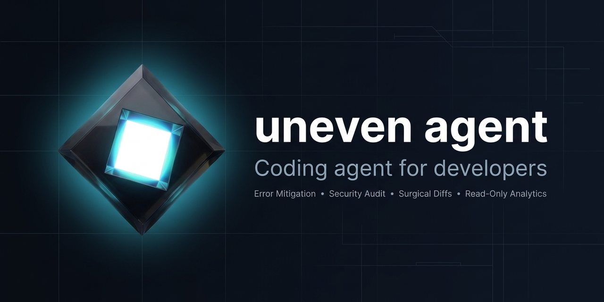

<p align="center">
  
</p>

# Uneven Agent: Coding Agent, Security Scanner & Desktop IDE


> Uneven is a coding agent with a CLI and native Desktop IDE. Write and review code, detect security issues and malware early, resolve terminal errors with rollback support, and analyze data to build dashboards from natural language without exposing sensitive data, using local models or your own API keys.

---

## Core Capabilities

- **Pre-Deploy Security & Malware Scanning**: Detect OWASP Top 10 vulnerabilities, hardcoded secrets, malicious code patterns, and supply-chain risks (CycloneDX SBOM) before code reaches production.
- **Privacy-Safe Data Analysis & Dashboards**: Query connected databases using natural language with automatic sensitive-column masking, generating interactive HTML dashboards and Excel reports without exposing sensitive data.
- **Coding Assistance & Real-Time Error Fixing**: Investigate your codebase, plan changes, run approved terminal commands during reasoning, and resolve build or runtime errors with automatic backups and rollback.
- **Layered Engineering Pods & Multi-Agent Workflows**: Organize work across isolated Database, Backend, Frontend, and DevOps layers with clear contract handoffs.
- **CLI + Native Desktop IDE**: Work from the terminal or launch the Desktop IDE directly in any repository with multi-tab terminals, visual diff inspection, and live token/cost telemetry.
- **Offline Models or Bring Your Own Key (BYOK)**: Run quantized local models offline, connect Ollama, or use your own OpenAI, Anthropic Claude, Google Gemini, or DeepSeek API keys.

---

## Installation

```bash
curl -fsSL https://uneven.dev/install.sh | bash
```

Native installers (`.deb`, `.dmg`, `.exe`) are available on the [Releases](https://github.com/kreivetech/uneven-agent/releases) page.

---

## Quick Start

```bash
uneven init                          # Configure provider (Local, Ollama, or API key)
uneven                               # Open interactive conversational shell
une .                                # Launch the Desktop IDE in the current project
uneven think "refactor auth layer"   # Plan, review, and apply code changes
uneven scan                          # Scan codebase for malware and supply-chain risks
uneven pentest                       # Security audit & SBOM generation [Pro]
uneven analyze                       # Natural-language data analysis & dashboards [Pro]
```

---

## Commands & Plans

| Capability | Command | Free | Pro |
|---|---|:---:|:---:|
| Conversational shell & codebase Q&A | `uneven`, `ask` | ✓ | ✓ |
| Deep reasoning, planning & code edits | `think`, `askf` | ✓ | ✓ |
| Layered Pods & multi-agent workflows | `pods`, `multi-agent` | ✓ | ✓ |
| Native Desktop IDE (`uneven-ui`) | `une .` / `uneven ide` | ✓ | ✓ |
| Knowledge base indexing, docs & explanations | `index`, `explain`, `docs` | ✓ | ✓ |
| Malware & supply-chain scanner | `scan` | ✓ | ✓ |
| Real-time terminal error watcher | `watch` | ✓ | ✓ |
| Activity logs, snapshots & rollback | `log`, `undo`, `restore` | ✓ | ✓ |
| Terminal auto-fix | `start` | - | ✓ |
| AI code review & CI/CD pipeline analysis | `review`, `ci` | - | ✓ |
| DevSecOps security auditing & SBOM | `pentest` | - | ✓ |
| Data analysis & interactive dashboards | `analyze` | - | ✓ |

Free tier includes unlimited BYOK and local usage across the CLI, Desktop IDE, and Pods.

---

## Providers, Languages & Requirements

**Brain Providers:** Local Offline (GGUF, CPU/CUDA/Metal), Ollama, OpenAI, Anthropic Claude, Google Gemini, DeepSeek.

**Supported Languages:** TypeScript, JavaScript, Python, Go, Java, PHP, Ruby, C/C++, Solidity, HTML/CSS, and database schemas.

**Minimum Requirements:**

| Mode | RAM | Disk | OS |
|---|---|---|---|
| API Providers (BYOK) | 256 MB | 200 MB | Linux, macOS, Windows 11 |
| Ollama | 512 MB (+ Ollama) | 200 MB + model | Linux, macOS, Windows 11 |
| Local Offline Brain | 4 GB (8 GB+ rec.) | 2 GB+ | Linux, macOS, Windows 11 |

---

## Configuration

Uneven runs out of the box without requiring configuration files in your repository. Configure providers, allowed database tables, security rules, or skills interactively inside the shell (`/models`, `/analyze`, `/fix`, `/skills`, `/urls`, `/effort`) or via environment variables (`GOOGLE_API_KEY`, `OPENAI_API_KEY`, `ANTHROPIC_API_KEY`, `DEEPSEEK_API_KEY`).

---

## Security & Privacy

- **On-Device Processing**: Codebase indexing, static scanning, and diff backups run on your machine.
- **Protected Data Analysis**: Database analysis enforces non-destructive queries with sensitive column masking and explicit approval before execution.
- **Reversible Changes**: Every automated edit creates a backup snapshot (`uneven undo` / `uneven restore`).

---

## Documentation, License & Support

- **Architecture & Guides**: [docs/ARCHITECTURE.md](docs/ARCHITECTURE.md) | [uneven.dev/docs/learn](https://uneven.dev/docs/learn)
- **License**: Business Source License 1.1 ([LICENSE](./LICENSE)), free for personal, learning, and non-commercial use; converts to Apache 2.0 on 2056-04-19. Commercial production use requires a license.
- **Disclaimer**: AI-generated code, database queries, and security findings must be reviewed before production use. Only run security audits against systems you are authorized to test.
- **Support**: [uneven.dev](https://uneven.dev) | [contact@kreive.com.br](mailto:contact@kreive.com.br) | [github.com/kreivetech](https://github.com/kreivetech)

© 2026 Kreive Tech. All rights reserved.
